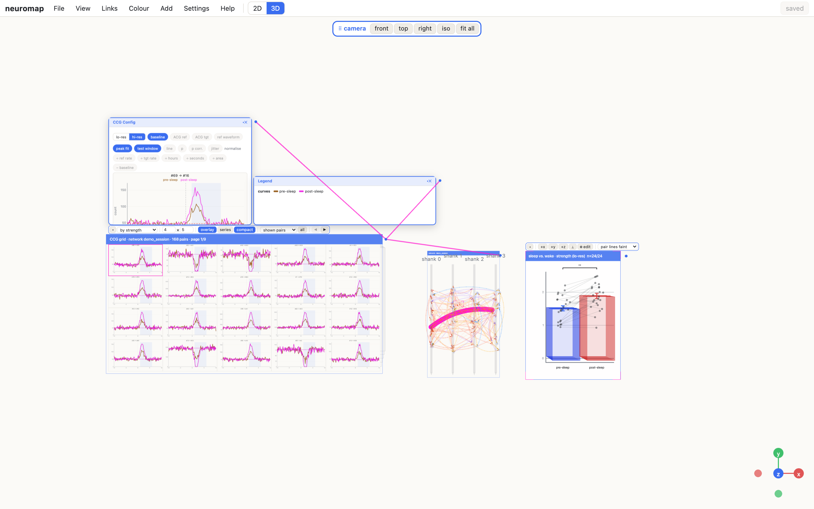

# inspo-neuro



<sub>Surrogate data (`docs/demo_screenshot.mjs`).</sub>

A 3D workspace for exploring neuron pairs and their cross-correlograms (CCGs). Neurons sit where they were recorded,
pairs are drawn as links, and stats tests, CCG grids and panels are objects you arrange around them.
It uses NeuroPy as its backend for data structures, analysis and saved selections.
Part of a series with inspoboard.

## Run

```sh
./run_server.sh                        # backend on :8765 (NEUROPY_ROOT points at your NeuroPy checkout)
cd web && npm install && npm run dev   # http://localhost:5174
```

## What it shows

- Neurons as dots (cards where they fit) in physical, embedding, axes or manual layouts; pairs as curved arrows.
- Several maps side by side, each for its own recording segment; the active map drives the CCG plot.
- Colour neurons by region, firing rate, rate ratio, tag or place cell; colour links by connection type, strength,
  strength change between two segments, or whether the connection is present in each.
- A CCG plot with low and high resolution, baseline, autocorrelograms of both neurons, waveform, peak fit
  (click a peak to call it), test window, p-values, normalisations and jitter.
- 3D: probes per shank (hover to fan a shank's neurons out, click to keep them out), an axis gizmo, and camera views.
- Stats tests as boards: one dot per value, bars with error bars or violins, significance brackets. Click a dot to open
  its CCG, double-click for the same pair in every group. A board can bring in its other sessions as layers behind the network.
- CCG grids fed by a network, a stats board or a pair filter. ⌘-click cards to pick pairs from any session (shift-click
  picks a run), then tag them with a group hotkey or move them with Shift S / U / D.
- Objects move, turn and snap as in a 3D modelling app: drag a title bar, press G for the gizmo, snap to an axis.
  A board and the network it is tied to move together.
- ⌘Z / ⇧⌘Z undo and redo both arrangement and edits.
- Named workspaces per project (File menu); a reload reopens the last one.

## Settings

`NEUROMAP_API_PORT` (8765) and `NEUROMAP_WEB_PORT` (5174) move the two servers; `NEUROMAP_STATE` moves this app's own
files (layouts, areas, workspaces, backups), which default to `state/` and are never committed.

## Writes

Tags, pair moves and peak calls are refused while NeuroPy's desktop GUI is open, since both would write the same
selection files. The first write of each server run backs those files up under `state/<project>/backups/`.
